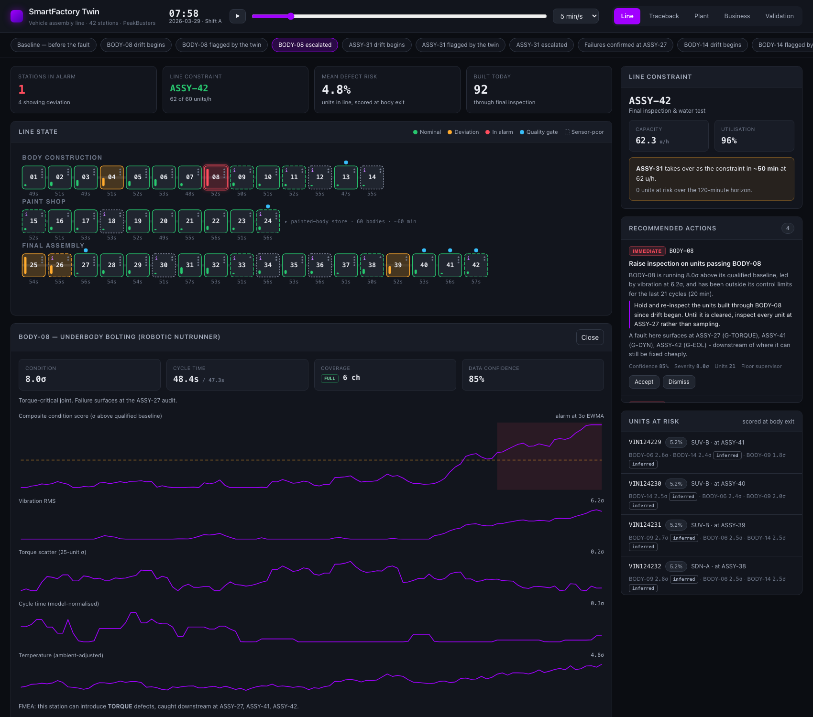
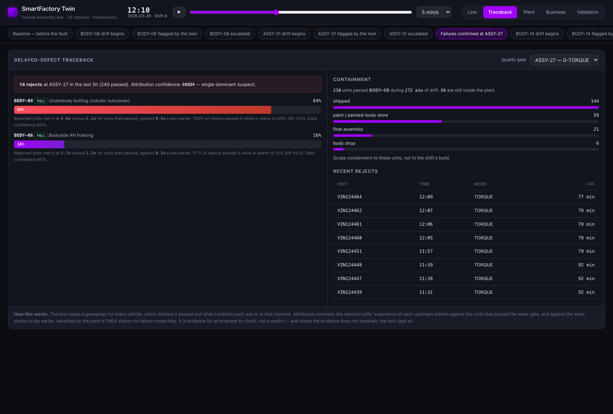
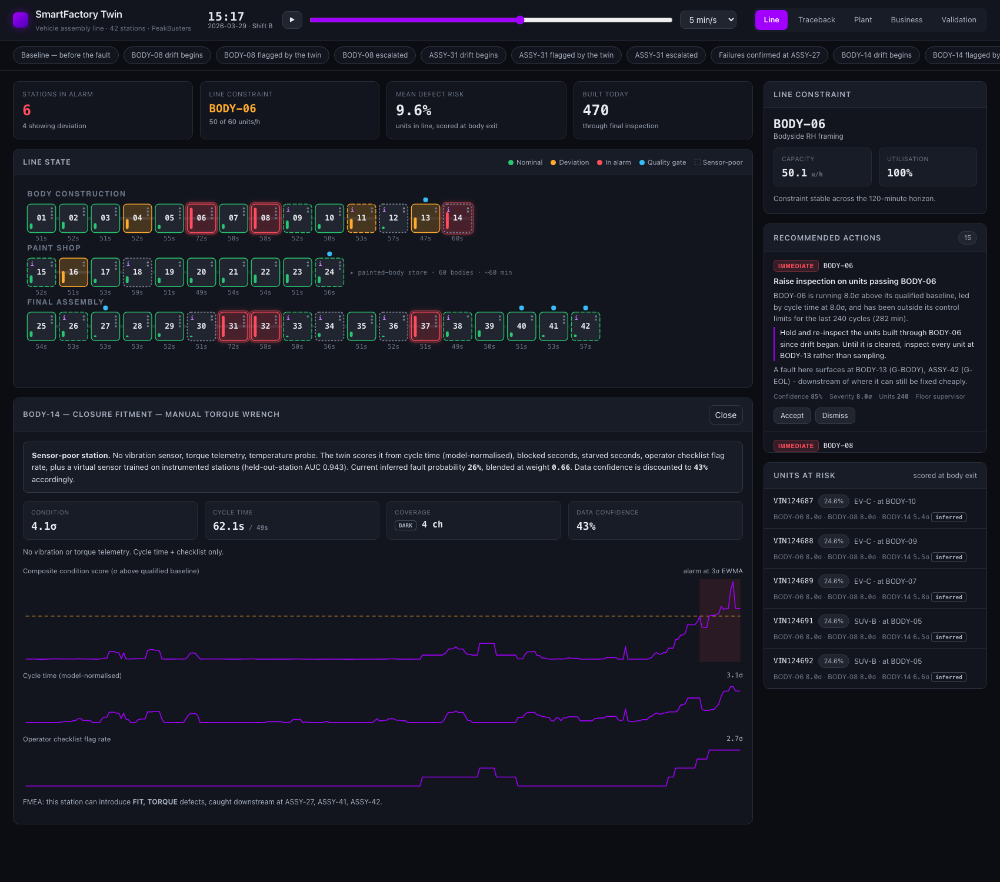
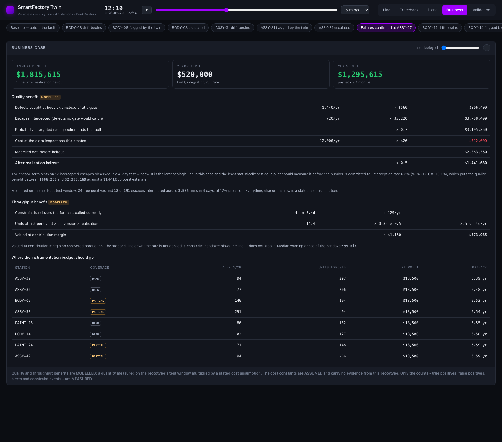

# SmartFactory Twin

### Don't wait for the defect.

A flow-level digital twin for a vehicle assembly line that detects a station
going bad **while it is still going bad**, and scopes containment to the vehicles
actually affected.

**Team PeakBusters** · Accenture Innovation Challenge 2026 · Problem Track 4, Round 2

**Repository:** https://github.com/avinas29/smartfactory-twin

---

## The problem, in one incident

At **07:12** a nutrunner spindle at BODY-08 begins to wear. Mean torque stays
inside the PLC acceptance window the whole time — only the *scatter* grows — so
every existing limit check stays green.

The first vehicle is rejected at **ASSY-27**, the chassis torque audit, roughly
**90 minutes and 240 vehicles later**. That is the moment a conventional plant
finds out. By then the question is no longer "what is wrong" but "how many, and
where are they now".

The SmartFactory Twin flags BODY-08 at **07:43** — 28 minutes in.

| | Conventional line | SmartFactory Twin |
|---|---|---|
| First signal | rejection at ASSY-27 | station alarm at BODY-08 |
| Elapsed | ~90 min | **28 min** |
| Question you can ask | "how big is the batch?" | "should we stop this now?" |
| Containment scope | the shift's build | **230 units, 86 still in the plant** |



---

## Run it

```bash
pip install -r requirements.txt
```

```bash
python run.py
```

First start builds the plant record and fits every model (~100 s, once), then
opens the dashboard at **http://localhost:8077**. Later starts reuse the artifacts.

```bash
python -m twin.pipeline    # rebuild everything, print the full validation report
python -m pytest tests -q  # 21 tests: leakage guarantees + regression cases
```

The dashboard replays a recorded production day against a clock you control.
Bookmarks jump straight to each incident; every view is deep-linkable
(`?t=<epoch>&view=trace&gate=27`), so a demo can return to an exact moment.

---

## What it does, in the order it does it

```
production telemetry
  -> digital twin state          per-station condition · unit genealogy · flow model
    -> anomaly detection         frozen-baseline SPC + virtual sensors for dark stations
      -> defect-risk prediction  calibrated, capacity-aware
        -> ranked traceback      genealogy contrast + FMEA prior, with confidence
          -> recommended action  four classes, human-in-the-loop
            -> business impact   every figure traceable to a measurement
```

**42 stations** across body construction, paint and final assembly, with a
painted-body store that puts ~60 minutes of decoupling buffer — and therefore ~60
minutes of detection lag — between a body-shop fault and where it surfaces.

| Coverage | Stations | What the twin can read |
|---|---|---|
| `FULL` | 28 (67%) | cycle time, blocking/starving, vibration, torque, temperature |
| `PARTIAL` | 8 (19%) | cycle time, blocking/starving, temperature |
| `DARK` | 6 (14%) | cycle time, blocking/starving, operator checklist |

Cycle time and blocking/starving come from MES part-scan timestamps and the
line-control PLC handshake. **Those exist on 1990s equipment** — which is the
entire reason the twin can score a station with no process telemetry at all. No
PLC is modified and no new sensor is required.

---

## The two things worth judging

### 1. Detection and containment

The twin does not need to predict a defect to be useful. It needs to notice a
station leaving its qualified envelope, and then tell you exactly which vehicles
went through it while it was out.



At 12:10 the torque audit has rejected 14 bodies. The twin contrasts what each
rejected unit experienced upstream against the units that passed the same gate,
and against the same station a day earlier, weighted by the plant's FMEA
station-to-failure-mode map. **BODY-08, 84% of the evidence, confidence HIGH.**

Containment is then scoped to units rather than batches: **230 units passed
BODY-08 during 272 minutes of drift; 86 are still inside the plant.**

**Ranked attribution with a confidence label — not root-cause prediction.** The
twin proposes suspects for an engineer to check.

### 2. Knowing when not to act

BODY-14 is a manual closure-fitment station: no vibration sensor, no torque
telemetry. It drifts too. The twin detects it — from cycle-time creep, the
operator checklist, and a virtual sensor trained on the plant's *instrumented*
stations — but **82 minutes in rather than 28**, and at 43% data confidence.



So it stays a **MONITOR**. A sensor-poor station is structurally barred from
raising an IMMEDIATE *quality* action — its condition evidence is inferred, and
inference cannot carry the cost of stopping work. It gets a watch item and a
costed instrumentation case instead.

It can still raise an IMMEDIATE *flow* action, and later that day it does: at
17:06 the twin says BODY-14 becomes the line constraint in 30 minutes, at 80%
confidence. That is not an inconsistency — cycle time is **measured** at every
station, including this one. The twin is confident the station is slowing the
line and unconfident about what it is doing to quality, which is exactly the
distinction the coverage tier should produce.

> **Strong evidence -> act. Weak evidence -> don't overreact.**

That asymmetry is the difference between a tool a supervisor keeps using and one
they learn to ignore.

---

## Evidence

Everything below is measured on a **held-out temporal split** — train days 0–19,
calibrate 20–23, test 24–27 — and reproduced by `python -m twin.pipeline`. All
three demo incidents fall in the test window.

### Detection

| | |
|---|---|
| Actionable alerts | **8.4 per shift** across all 42 stations |
| BODY-08 (instrumented) detected | **28 min** after onset |
| ASSY-31 (instrumented) detected | 50 min after onset |
| BODY-14 (**sensor-poor**) detected | 82 min after onset |
| Healthy stations | 99th percentile condition score 2.8σ |

Control limits are **fitted on a qualification window and then frozen**, with
assignable-cause points trimmed out of the baseline. A continuously self-updating
baseline is how you build a drift detector that cannot detect drift — it
re-centres on the fault.

### Traceback — scored against ground truth

The simulator records which station actually created every defect. The twin never
sees that column.

| Reported confidence | Windows | Top-1 correct | Top-3 correct |
|---|---|---|---|
| **HIGH** | 32 | **69%** | 84% |
| MEDIUM | 15 | 47% | 87% |
| LOW | 32 | 22% | 72% |
| All windows | 79 | 46% | 80% |
| *Random upstream station* | — | *5%* | — |

The number that matters is not 46%. It is that **accuracy tracks the confidence
the twin reported at the time**. An attribution engine that always names a
station will eventually send a crew to a healthy one.

### Virtual sensors for dark stations

| | |
|---|---|
| Held-out-**station** ROC-AUC | **0.94** |
| PR-AUC | 0.60 against a 0.04 base rate |
| Trust weight applied | 0.89 |

Trained to predict what vibration and torque channels *would* be saying, from
signals every station produces regardless of age. Validated by holding out whole
stations — because that is the deployment question. The validated score becomes
the blending weight: a mapping that did not generalise cannot raise an alarm.

### Defect-risk model

Predicts, at body exit, whether a unit will be flagged at a downstream gate.

| Population | ROC-AUC | PR-AUC | Base rate | Lift |
|---|---|---|---|---|
| All downstream failures | 0.651 | 0.168 | 0.104 | ×1.63 |
| **Reachable failures only** | **0.767** | 0.150 | 0.061 | **×2.46** |
| *Null model — labels shuffled* | *0.397* | *0.084* | *0.104* | *×0.82* |

False-alarm rate **5.5%**, Brier score 0.091, 25 flagged units per shift against
a stated inspection capacity of 25.

**Read this honestly.** Roughly half of downstream failures originate *after* the
decision point, in paint or final assembly; no body-exit model can reach those
under any architecture. The bootstrap 95% interval on test ROC-AUC is
[0.62, 0.68] — which also means the three model families we fitted are
statistically indistinguishable, so we do not claim the selected one is better.
**This is the weakest of the three predictive components, and we would not lead
with it.**

### Bottleneck forecast

36% of constraint-handover calls verified, median **95 minutes** of warning.
Eleven calls is a small sample and is reported as such.

---

## Business case



| | |
|---|---|
| Annual benefit, one line | **$1.82M** |
| Year-1 cost | $520K |
| Payback | **3.4 months** |

Every line of arithmetic is visible in the Business view and in
[`twin/economics.py`](twin/economics.py). Two conservatism factors are applied
explicitly rather than buried: a 0.70 probability that a targeted re-inspection
actually finds the fault, and a 0.50 realisation haircut on everything modelled.

The largest single line — warranty exposure avoided on intercepted escapes —
rests on **11 events in a 4-day window**. Its 95% interval puts the quality
benefit between **$0.89M and $2.36M** against a $1.44M point estimate. That
interval is shown in the UI, because it is the least settled number in the case.

---

## What is real, and what is not

| | |
|---|---|
| **Genuinely implemented** | SPC baselines and drift detection · virtual sensors · feature pipeline · model training, calibration and selection · bottleneck forecast · traceback and containment · recommendation engine · economics |
| **Simulated** | The plant. Telemetry, defect creation and gate detection come from a generator with a latent causal model the twin never sees. |
| **Proposed for production** | MES / PLC / OPC-UA connectors · multi-plant rollout · model registry and retraining schedule · auth and audit trail |
| **Business-case assumptions** | All cost constants. A plant substitutes its own. |

Everything downstream of the generator is code that would run unchanged against a
real MES feed. Ground truth is named `oracle_*`, **stripped from the file the
dashboard loads**, and a test fails if any module outside the generator
references it.

---

## Architecture

```
twin/
  config.py          line layout, sensor tiers, gates, economics constants
  generate.py        the synthetic plant - latent causal model
  spc.py             frozen-baseline control charts, drift episodes
  virtual_sensor.py  thin-evidence -> rich-evidence transfer for dark stations
  features.py        per-unit feature engineering at the decision point
  model.py           training, calibration, model selection, metrics
  flow.py            queueing roll-forward, bottleneck forecast
  tracing.py         genealogy traceback, containment, accuracy validation
  recommend.py       four-class recommendation engine
  economics.py       business case - MEASURED / MODELLED / ASSUMED kept apart
  pipeline.py        build everything, write artifacts, print the report

app/
  main.py            FastAPI - replays the record against a client-controlled clock
  static/            dashboard: no framework, no build step, no CDN
```

One process and a browser. No microservices, no Kubernetes, no cloud.

---

## Further reading

- **[docs/INTEGRATION.md](docs/INTEGRATION.md)** — the six tables the twin reads,
  why nothing is written back to the PLC, and a three-phase shadow-mode plan for
  validating this on a real line, including the criteria that would falsify it.
- **[docs/LIMITATIONS.md](docs/LIMITATIONS.md)** — the challenges we expect a
  technical reviewer to raise, each answered with a measurement or acknowledged
  as a limitation. Includes a real lookahead bug found and fixed during
  adversarial review.
- **[docs/BUSINESS-PROPOSAL.pdf](docs/BUSINESS-PROPOSAL.pdf)** — the full case.

---

**Repository — clone, run, and reproduce every figure:** https://github.com/avinas29/smartfactory-twin

<sub>`data/` and `artifacts/` are gitignored and regenerate deterministically from the seed.</sub>
